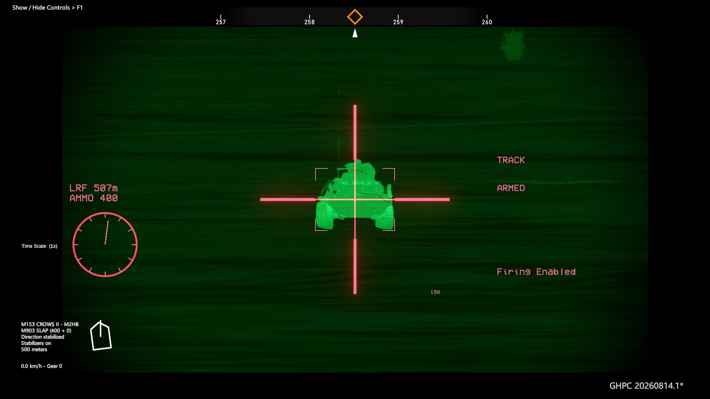

[English](README.md) | [简体中文](README.zh-CN.md)

---

# 素材出处
M153 CROWS 模型来自："MRAP Oshkosh (West)"（https://marketplace.vigilante.us/product/mrap-oshkosh-west/），作者 Vigilante

CITV 与 M256 模型来自："WIP - Abrams M1A2 TUSK 2"（https://skfb.ly/VUwX），作者 DavidFalke

---

# 致原作者

**本仓库是 [thebeninator/M1A1Abrams](https://github.com/thebeninator/M1A1Abrams) 的 Fork。**


同时感谢 **Vigilante** 提供 M153 CROWS 模型、**DavidFalke** 提供 CITV 与 M256 模型。

> 上游 `master` 仍然是这个 mod 的权威版本。如果你要的是不含 CROWS 的原版 M1A1 Abrams mod，
> 请使用 [thebeninator 的仓库](https://github.com/thebeninator/M1A1Abrams)。

# M1A1 Abrams
Gunner, HEAT, PC! 的 mod，需要 [MelonLoader](https://github.com/LavaGang/MelonLoader/)。

适配 20261014。

修复 CITV。

修复 CROWS。

玩法/安装教程：https://www.youtube.com/watch?v=e_qNIyBb2SA

如果通过 Steam 启动报错，请直接运行游戏主程序。


---

带预设（Preset）系统，可自定义随机化


---

<p>
把所有 M1IP 转换为 M1A1，装备：
	<ul>
	<li>120mm M256 火炮</li>
	<li>M829 APFSDS-T（22 发）</li>
	<li>M830 HEAT-MP-T（18 发，带弹头引信）</li>
	</ul>
</p>

# 额外功能 / 设置（在 mod 配置里）
- 可选穿甲弹：M827、M829、M829A1、M829A2、M829A3、M829A4
  （M829A4：长杆贫铀弹，1,565 m/s，炮口穿深比本 mod 的 M829A3 高 6.5%，对重型爆炸反应装甲的
  穿透能力是它的两倍——见下文 M829A4 章节）
- 可选破甲弹：M830A1（带近炸引信，双击该弹种热键切换）
- 自定义每辆 M1A1/E1 携带多少发 M829 与 M830
- 以下选项默认关闭：
	- 把非 IP 的 M1 转换为 M1E1
	- 随机化 M1A1/E1 改装
	- M1A1/E1 提前量修正时的水平瞄准线稳定
	- 车长 CITV
	- M1A1 的贫铀炮塔侧装甲
	- M153 CROWS（由本 Fork 移植并修好，见下文）
	- 炮长热成像的不同设置

# 改装谱系

<p>M1A1：所有设置关闭</p>
<p>M1A1HA：贫铀装甲（gen = 1）</p>
<p>M1A1HC：贫铀装甲（gen &gt; 1）</p>
<p>M1A2：方位旋转、CITV、贫铀装甲（gen &gt;= 1）</p>
<p>M1A2 SEP：M1A2、FLIR 代次 = 3 或 CROWS</p>

---

# 本 Fork 增加了什么

| | 上游 `master` | 本 Fork |
|---|---|---|
| M153 CROWS II | 配置项声明了，但从不创建、从不使用，README 标着 *"CURRENTLY NOT FUNCTIONAL"* | 移植进来、装上车、端到端可用 |
| CROWS 自动跟踪 | — | 目标锁定、目标框、提前量解算、自动测距 |
| CROWS 瞄具 | — | 白天 + 热成像两套瞄具，1X/5X/10X/15X，瞄准镜内 UI，方位环 |
| CROWS 弹药 | — | 可选 M8 API / Mk 211 Mod 0 / **M903 SLAP + M962 SLAP-T** 弹链 |
| 同轴机枪 | M240 | 可选 M2HB，与 CROWS 共用同一套弹链选择 |
| M829A4 APFSDS-T | — | **新增弹种**，穿深按本 mod 自己的 M829A3 折算 |

其余一切——预设系统、改装谱系、贫铀装甲、CITV、FLIR 代次、M830A1、原有穿甲弹家族——都是上游的成果，
行为与上游完全一致。

---

# M153 CROWS II

**M153 CROWS II**（Common Remotely Operated Weapon Station，通用遥控武器站）把车长那挺暴露在外的
.50 机枪换成遥控的 M2HB 武器站：车长在装甲下瞄准射击，由稳定式瞄具、激光测距仪和火控计算机完成弹道解算。



## 怎么打开

在 `Bin/UserData/MelonPreferences.cfg` 的 `[M1A1Config]` 节：

```toml
"CROWS (M1E1)" = true          # M1E1（由非 IP 的 M1 改装而来）
"CROWS (M1A1)" = true          # M1A1 / M1IP
"Alternative Position" = false # true = 武器站移到车长右侧
"CROWS/M2 Ammo" = "M8 API"     # M8 API | Mk 211 Mod 0 | M903 SLAP
"M2 Coax" = false              # true = 同轴换成 M2HB，共用同一套弹链
```

资源包 `m1a1assets`（内含 `m1a1assets/crows`）必须已存在于游戏的 `Mods` 目录。

别的构建留下的旧键名（`CROWS (M1E1) <DISABLED>`、`CROWS (M1A1) <DISABLED>`、`CROWS Alt Placement`、
`CROWS: Alternate Placement (Global)`、`Use Mk 211 Mod 0`、`CROWS Raufoss`、
`CROWS: Raufoss Ammo (Global)`、`M2 SLAP`）会直接从配置文件里读取并在首次运行时迁移，所以老配置不会失效。
启动时日志会打印一行当前生效值。

## 功能

**武器站本体**
- 尾部鞭状天线切换成直立双天线构型，避免与武器站穿模。只改生成的车辆实例，未解包的 prefab 保持原样。

**瞄具**
- 白天与热成像两套瞄具，各自是完整注册进游戏相机系统的相机槽。
- 倍率 **1X / 5X / 10X / 15X**，对应 30° / 6° / 3° / 2° 视场角。
- 准星按瞄具缩放，并使用武器站自己的瞄具颜色绘制。
- 热成像的抖动模糊与抖动量归零，与白天瞄具保持一致。

**伺服**
- 额定横转 **90°/s**、俯仰 **50°/s**

**自动跟踪（ATT）**
- **鼠标中键**锁定 / 解锁。
- 锁定后：目标被框住、提前量解算完成、瞄具被驱动到目标上。
- 锁定时切断玩家自己的瞄向输入，武器站不会跟跟踪器对着干。
- **瞄准镜内 UI**：`LRF <米数>`、`AMMO <余弹>`、`ARMED`、`Firing Enabled` / `Firing Blocked`、
  `TRACK` / `TRACK LEAD`、倍率标签，以及画面左下角的方位环。

# CROWS 与同轴 .50 弹药

武器站和可选的 M2HB 同轴**共用同一套弹链选择**，由 `CROWS/M2 Ammo` 决定：

| 配置值 | 弹链 |
|---|---|
| `M8 API` | 4 发 M8 API + 1 发 M20 API-T（原版） |
| `Mk 211 Mod 0` | 4 发 Mk 211 HEIAP + 1 发 Mk 30 HEIAP-T，保留高爆燃烧效果 |
| `M903 SLAP` | 4 发 **M903 SLAP** + 1 发 **M962 SLAP-T** |

`M962` 是 M903 弹链里的曳光弹，不单独提供选项。

`M2 Coax = true` 把 M240 同轴换成 M2HB

---
## 新增的 SLAP 弹种
- 初速均为 **1,219 m/s**；

  | 距离 | 穿深（mm RHA） |
  |---|---|
  | 500 m | 34.0 |
  | 1,200 m | 22.62 |
  | 1,500 m | 19.0 |

---
# M829A4 APFSDS-T

新增的 120 mm 穿甲弹，加入 M827 / M829 / M829A1 / M829A2 / M829A3 这一组可选穿甲弹。

| | M829A3（原有） | **M829A4（新增）** |
|---|---|---|
| 初速 | 1,555 m/s | **1,565 m/s** |
| 阻力质量 | 5.2 kg | **5.8 kg** |
| 截面积 | 0.00086 | **0.0009** |
| 阻力系数 | 0.22 | **0.20** |
| `RhaPenetration` | 690 | **735** |
| 重型 ERA 系数 | 0.25 | **0.125** |
| 破片倍率 / 上限 / 下限 | 1.2 / 22 / 7 | **1.25 / 24 / 8** |
| 2,000 m 穿深 | 579 mm RHAe | **633 mm RHAe** |

---

# 环境要求与构建

- Gunner, HEAT, PC!，已安装 [MelonLoader](https://github.com/LavaGang/MelonLoader/)。

---